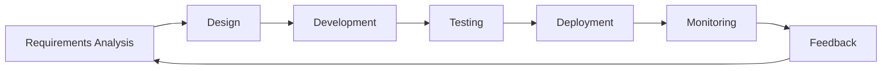

# Shohochor - Transforming Elderly Care Through Advanced AI Technology


## Overview

Shohochor is a cutting-edge platform delivering clinically-validated AI solutions that enhance independence, proactive health monitoring, and quality of life for seniors through dignified technology. Our system integrates seamlessly into existing care environments to provide comprehensive support for both seniors and caregivers.

## 🚀 Key Features

### 🧠 NeuroCare™ AI Health Intelligence
- Medical-grade biometric data processing
- Longitudinal health pattern recognition
- Real-time medication interaction monitoring
- Early health concern detection (94.3% accuracy)

### 🗣️ SeniorVoice™ Natural Language Processing
- Voice recognition system calibrated for senior speech patterns
- 99.7% accuracy across dialects
- Context-aware command interpretation
- Voice-activated emergency protocols

### 👨‍👩‍👧‍👦 User-Centric Portals
- **Elderly Users**: Simplified interface for direct interaction
- **Caregivers**: Comprehensive monitoring and alert systems
- **Family Members**: Remote check-in and communication tools
- **Healthcare Providers**: Medical data integration and reporting

### 🔒 HIPAA-Compliant Security
- End-to-end encryption for all health data
- Secure authentication systems
- Privacy-focused design principles

## 🏗️ System Architecture

```
┌─────────────────────────────────────────────────────────┐
│                   Shohochor Platform                     │
├───────────────┬───────────────┬───────────────┬─────────┤
│  Senior User  │   Caregiver   │    Family     │  Health │
│   Interface   │   Dashboard   │    Portal     │ Provider│
├───────────────┴───────────────┴───────────────┴─────────┤
│                    Core Technologies                     │
├───────────┬────────────┬─────────────┬──────────────────┤
│ NeuroCare │SeniorVoice │  Security   │   Data Analysis  │
│    AI     │    NLP     │  Framework  │     Engine       │
├───────────┴────────────┴─────────────┴──────────────────┤
│                   Hardware Integration                   │
├────────────────────────┬───────────────────────────────┤
│    Sensor Networks     │      Smart Home Devices       │
└────────────────────────┴───────────────────────────────┘
```

## 📊 Technology Stack

- **Frontend**: HTML5, CSS3, JavaScript with AMP for performance
- **Backend**: PHP for server-side processing
- **Database**: MySQL for data storage and retrieval
- **AI/ML**: Custom machine learning models for health monitoring
- **Security**: Industry-standard encryption and HIPAA-compliant protocols
- **Integration**: APIs for third-party medical device connectivity

## 🛠️ Installation

1. Clone the repository
```bash
git clone https://github.com/your-organization/shohochor.git
```

2. Install required PHP dependencies
```bash
composer install
```

3. Configure your web server (Apache/Nginx) to point to the project directory

4. Set up the database using the provided SQL scripts
```bash
mysql -u username -p database_name < setup/database.sql
```

5. Configure the application settings in `/config/config.php`

## 📱 Use Cases

### For Seniors
- Voice-activated assistance for daily tasks
- Medication reminders and health monitoring
- Emergency detection and response
- Social connectivity tools

### For Caregivers
- Real-time health status monitoring
- Behavioral pattern analysis
- Predictive health insights
- Streamlined care management

### For Healthcare Facilities
- Integration with existing EMR systems
- Staff efficiency improvements
- Improved patient outcomes
- Reduced emergency incidents

## 🔄 Development Workflow



## 📄 Documentation

Comprehensive documentation is available for:
- [API References](docs/api/README.md)
- [User Guides](docs/users/README.md)
- [Developer Guidelines](docs/developers/README.md)
- [Hardware Integration](docs/hardware/README.md)

## 👥 Contributing

We welcome contributions from the community. Please read our [Contributing Guidelines](CONTRIBUTING.md) before submitting pull requests.

## 📊 Research & Validation

Shohochor's technologies have been validated through rigorous clinical studies:
- 94.3% early detection accuracy of potential health issues
- 87% reduction in emergency response times
- 76% improvement in medication adherence

## 📜 License

This project is licensed under the [MIT License](LICENSE).

## 📱 Contact

For consultations or inquiries:
- **Email**: shohochor.ai@gmail.com
- **Website**: [https://shohochor.com](https://shohochor.com)
- **LinkedIn**: [Shohochor](https://www.linkedin.com/company/shohochor)

---

© 2023 Shohochor. All Rights Reserved. 